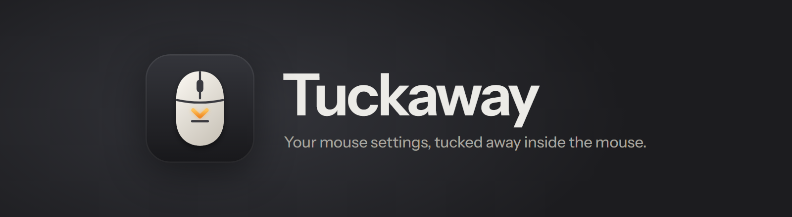
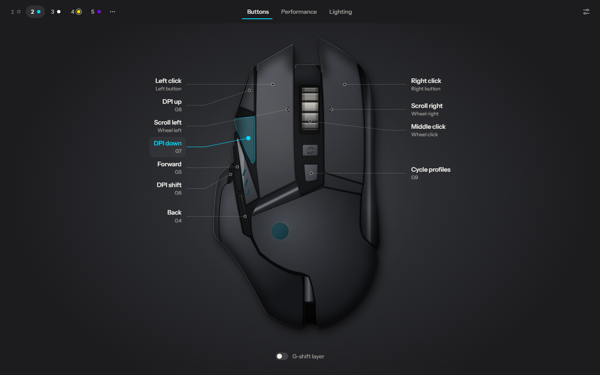
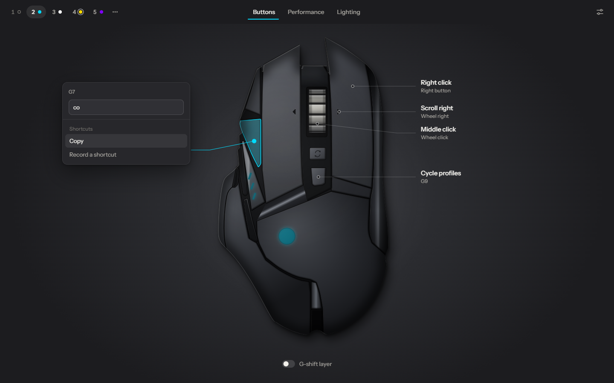
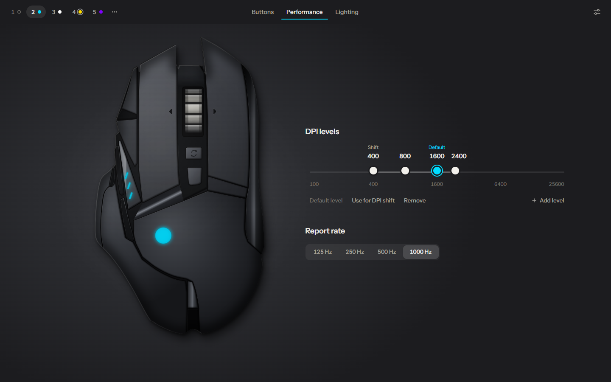
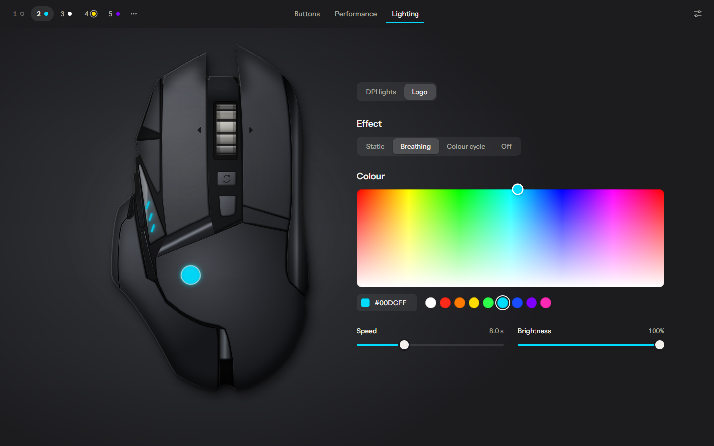
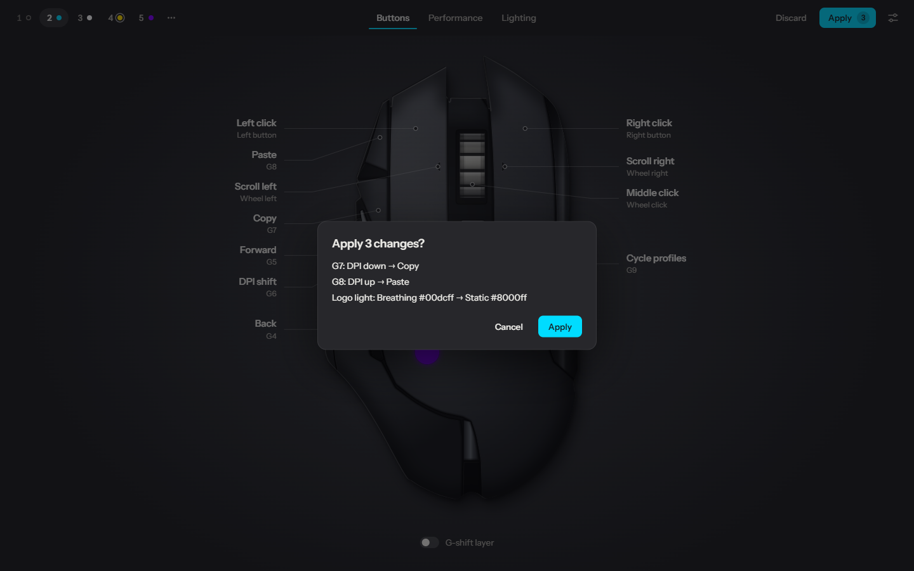

<p align="center">
  <picture>
    <source media="(prefers-color-scheme: light)" srcset="docs/assets/banner-light.png">
    
  </picture>
</p>

<p align="center">
  <a href="https://github.com/Maxikozie/Tuckaway/releases/latest"></a>
  <a href="https://github.com/Maxikozie/Tuckaway/releases"></a>
  
  
  <a href="LICENSE"></a>
</p>

<p align="center">
  <b>Remap the buttons, tune the DPI and set the lighting of a Logitech G502 HERO,<br>
  then close the app. Everything is stored in the mouse itself.</b>
</p>

<p align="center">
  <a href="#download">Download</a> ·
  <a href="#features">Features</a> ·
  <a href="#safe-by-design">Safe by design</a> ·
  <a href="#faq">FAQ</a> ·
  <a href="#build-from-source">Build from source</a> ·
  <a href="docs/protocol.md">How it works</a>
</p>

<p align="center">
  
</p>

Gaming mice keep up to five profiles in their own memory. Tuckaway edits that memory directly over Logitech's HID++ protocol, so there's no G HUB, no background service and no account. Set it up once, close Tuckaway, and your buttons, DPI levels and lighting go with the mouse to any computer.

> [!NOTE]
> Tuckaway is an independent open-source project. It is not made, endorsed or supported by Logitech. Logitech, G502 and HERO are trademarks of Logitech.

## Download

**[Download Tuckaway.exe](https://github.com/Maxikozie/Tuckaway/releases/latest/download/Tuckaway.exe)** from the latest release. It's a single portable file of about 4 MB: no installer, nothing to uninstall.

- Needs Windows 10 or 11 (64-bit) with the WebView2 runtime, which every up-to-date Windows 11 PC already has.
- The exe isn't code-signed yet, so SmartScreen may say *Windows protected your PC*. Choose **More info → Run anyway**, or check the file against `SHA256SUMS.txt` in the release first.

## Features

- **Every button, on the mouse itself.** Each button has a callout with what it does (*Copy*, *DPI down*, *Play / pause*). Click one to pick a new action from a searchable list. Copy, Paste, Cut, Undo, Redo, Select all and Save are one click, and any other shortcut can be recorded.
- **Keyboard shortcuts that respect your layout.** Shortcuts are stored by physical key and labelled for your keyboard. On AZERTY, *Select all* really sends Ctrl+A.
- **A second layer with G-shift.** Give each button a second action while a G-shift button is held.
- **DPI on one track.** Drag up to five DPI stops on a log scale that snaps to the sensor's real 50-DPI steps. Click a stop to type an exact value or to make it the default or the sniper level. Report rate is 125, 250, 500 or 1000 Hz.
- **Live lighting.** Click the DPI lights or the logo, pick Static, Breathing, Colour cycle or Off, and watch both the drawing and the real mouse change as you drag. Nothing is saved until you apply.
- **Five profiles.** Switch the profile you're editing, make one active, or disable the ones G9 should skip.
- **Plain-language apply.** Before anything is written you see exactly what changes, for example *G7: DPI down → Copy* or *Report rate: 1000 → 500 Hz*.
- **Backups, restore, import and export.** Every connection and every write is backed up first. Profiles can be shared as JSON files.

<table>
  <tr>
    <td width="50%"><br><sub><b>Pick an action</b>, grouped and searchable, with one-click presets</sub></td>
    <td width="50%"><br><sub><b>DPI levels</b> on a log-scale track, plus report rate</sub></td>
  </tr>
  <tr>
    <td width="50%"><br><sub><b>Lighting</b> with a live preview on screen and on the mouse</sub></td>
    <td width="50%"><br><sub><b>Apply</b> lists every change in plain words</sub></td>
  </tr>
</table>

## Quick start

1. Plug in the mouse and start `Tuckaway.exe`. It finds the mouse by itself and saves a backup of its memory.
2. Pick a profile at the top. Its coloured dot is that profile's lighting, and the ring marks the profile the mouse is using right now.
3. Change what you like in **Buttons**, **Performance** and **Lighting**. An **Apply** button appears with the number of changes.
4. Click **Apply**, read the list, and confirm. Tuckaway writes, checks and reloads the mouse.
5. Close Tuckaway. The mouse keeps working exactly as you set it, on this PC and any other.

Close G HUB or any other mouse software while you use Tuckaway; two programs writing the same memory will confuse each other.

## Safe by design

> [!IMPORTANT]
> Tuckaway writes to your mouse's flash memory. These rules are enforced in code, not left to the interface:

- **Backup first.** A full backup is saved on every first connection and before every write, restore or factory reset. The code that writes a sector can't run without one.
- **Checksums and limits.** Each profile is sealed with its CRC. The factory (ROM) area, sectors that don't exist and data of the wrong length or with a bad CRC are refused.
- **Read-back verification.** Every written sector is read back and compared byte for byte, then the whole memory is re-read and checked against your edit.
- **Patch, don't rewrite.** Only the fields you changed are written. Unknown and reserved bytes are kept as they were.
- **No stale writes.** Right before writing, Tuckaway re-reads the mouse. If its memory changed in the meantime, nothing is written.
- **A deliberate confirm.** The Apply dialog opens on *Cancel* and ignores keypresses for the first moment, so a stray Enter can't write anything.
- **Lighting previews live in RAM only**, and the mouse goes back to its saved lighting on Discard, after Apply, on a profile switch and when Tuckaway closes.

Backups live in `%LOCALAPPDATA%\Tuckaway\backups`. **Settings → Restore from backup** puts any of them back, and **Factory reset** copies the factory profiles from the mouse's ROM.

## Supported mice

| Mouse | USB id | Status |
| --- | --- | --- |
| Logitech G502 HERO (wired) | `046d:c08b` | Supported and tested (firmware U1 27.03.B0010) |

Other mice that use the same onboard-profile format will probably work but are refused until their product id is added to `SUPPORTED_PRODUCT_IDS` in [`crates/hidpp/src/device.rs`](crates/hidpp/src/device.rs). Dumps from other models are very welcome in an issue.

## FAQ

<details>
<summary><b>Do I need G HUB?</b></summary>

No. Tuckaway talks to the mouse directly. You can uninstall G HUB, or keep it and simply not run both at once.
</details>

<details>
<summary><b>Does anything keep running after I close Tuckaway?</b></summary>

No. The settings are in the mouse. There's no service, tray icon or startup entry.
</details>

<details>
<summary><b>My lighting changes don't show on the mouse.</b></summary>

Windows *Dynamic Lighting* (Logitech's LampArray service) can take over the mouse's LEDs. The Lighting tab tells you when that service is running. Turn Dynamic Lighting off for the mouse in Windows Settings, or stop the service, and the colours show again.
</details>

<details>
<summary><b>How do I undo everything?</b></summary>

Use **Settings → Restore from backup** and pick the backup from your first connection, or **Settings → Factory reset** to go back to how the mouse left the factory.
</details>

<details>
<summary><b>Why does it say "Disabled" for profile 1?</b></summary>

Disabled profiles are skipped when you press the profile button (G9). Right-click a profile at the top to enable it again.
</details>

<details>
<summary><b>Can I bind a macro?</b></summary>

Not yet. Existing macros are shown and kept intact, but can't be edited.
</details>

## Command-line tool

`tuckaway-cli.exe` is attached to each release for scripting and debugging. Commands that write are dry runs unless you add `--yes`.

```text
tuckaway-cli list                                 HID collections and supported mice
tuckaway-cli dump [--raw] [--from F]              read, back up and decode the onboard memory
tuckaway-cli backup [DIR]                         save a raw backup
tuckaway-cli restore FILE [--yes]                 write a backup back
tuckaway-cli activate N                           select onboard profile N
tuckaway-cli set P SLOT BINDING [--gshift] [--yes]
                                                  change one button
```

`BINDING` is one of `key:Ctrl + C`, `mouse:N`, `consumer:Play/Pause`, `function:dpi_up` or `disabled`.

## Build from source

You need Rust (stable, MSVC toolchain), Node.js 20 or newer, and the Visual Studio Build Tools with the *Desktop development with C++* workload.

```bash
npm --prefix ui install
VITE_PUBLIC=1 npm --prefix ui run build
cargo build --release -p app --features custom-protocol
cargo build --release -p cli
```

That gives `target/release/tuckaway.exe` and `target/release/tuckaway-cli.exe`. Release builds link the C runtime statically, open no console window, and use LTO.

Tests, lints and a mouse-free development setup:

```bash
cargo test --workspace
cargo clippy --workspace --all-targets -- -D warnings
npm --prefix ui run check
npm --prefix ui test
npm --prefix ui run dev
TUCKAWAY_MOCK=1 cargo run -p app
```

`TUCKAWAY_MOCK=1` serves a real dump of the mouse from memory instead of the device. Writes stay in memory and no backups are saved, so you can try everything safely.

## Project layout

```text
crates/hidpp   HID++ 2.0 protocol, device I/O, profile decode/encode, CRC, backups (no GUI)
crates/app     Tuckaway (Tauri 2): commands, device thread, mock mouse, key labels
crates/cli     tuckaway-cli
ui/            Svelte 5 + TypeScript frontend
docs/          protocol notes and README assets
```

[docs/protocol.md](docs/protocol.md) explains the transport, the onboard-profile feature, the memory layout, the CRC and how key capture works.

## Credits

The protocol knowledge comes from the open-source projects [libratbag](https://github.com/libratbag/libratbag) (MIT), [Solaar](https://github.com/pwr-Solaar/Solaar) (GPL-2.0) and [piper](https://github.com/libratbag/piper), checked against dumps of a real mouse. Tuckaway is an independent Rust implementation; its logo is original. Typeface: [Instrument Sans](https://github.com/Instrument/instrument-sans) (OFL).

## License

[MIT](LICENSE) © 2026 Maximilian Schutte
